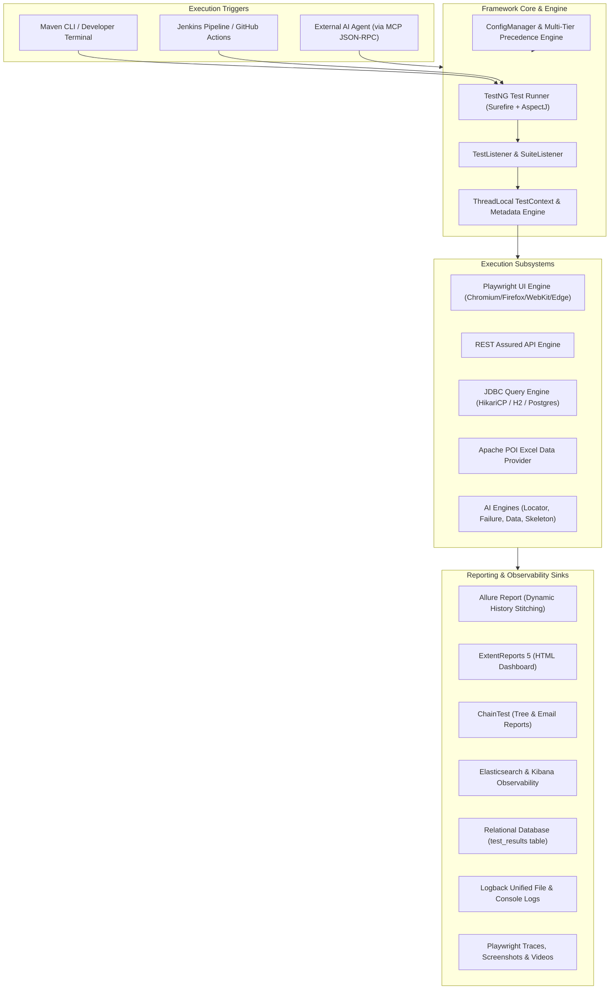
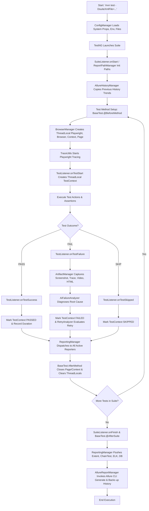
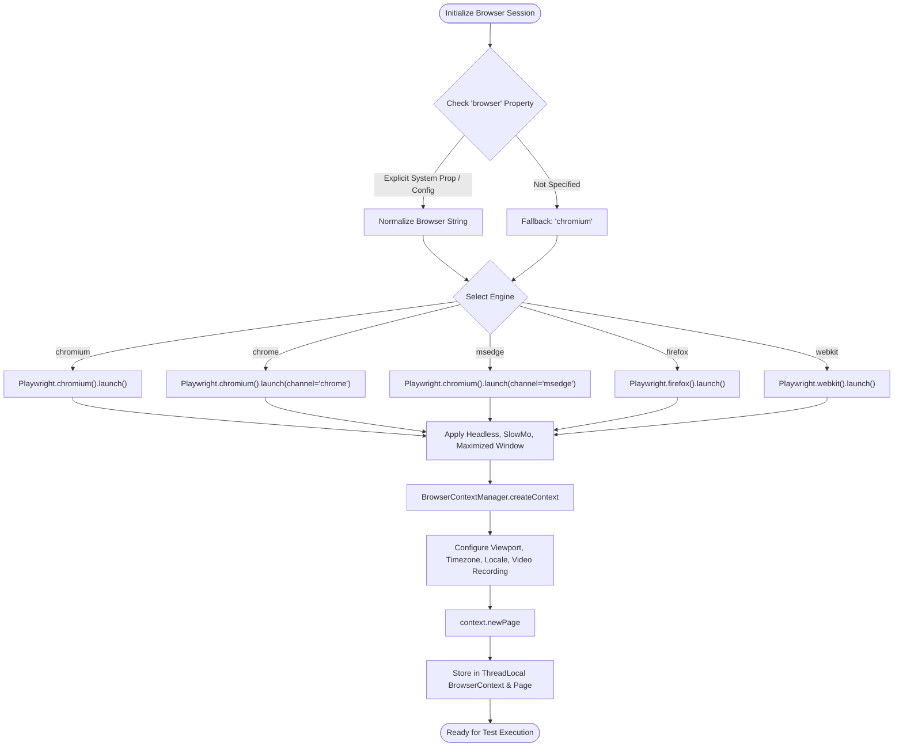
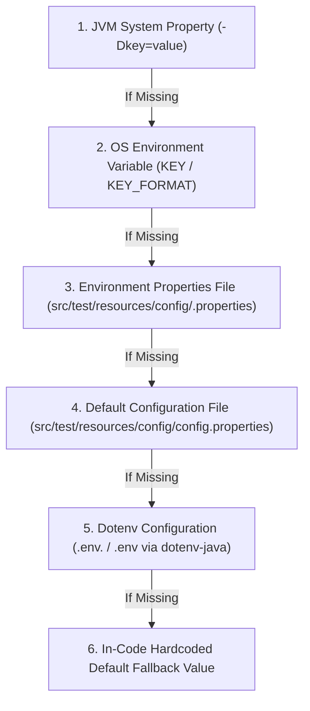

# Enterprise Playwright Java Hybrid Automation Framework

[](https://www.oracle.com/java/)
[](https://playwright.dev/java/)
[](https://testng.org/)
[](https://rest-assured.io/)
[](https://allurereport.org/)
[](https://www.extentreports.com/)
[](https://github.com/anshooarora/chaintest)
[](https://www.elastic.co/)
[](https://www.docker.com/)
[](LICENSE)

An enterprise-grade, full-stack test automation framework developed with **Java 21, Playwright Java, TestNG, REST Assured, JDBC / HikariCP, Apache POI, ExtentReports, Allure (with automated cross-run history stitching), ChainTest, Reporting-Labs, SLF4J / Logback, Docker, Jenkins CI/CD, Artificial Intelligence (AI) test generation & failure diagnostics, and Model Context Protocol (MCP)** tool execution.

---

## Table of Contents

1. [Executive Summary & Framework Highlights](#1-executive-summary--framework-highlights)
2. [Module & Package Inventory](#2-module--package-inventory)
3. [Framework Architecture](#3-framework-architecture)
4. [Architecture & Workflow Diagrams](#4-architecture--workflow-diagrams)
5. [Unified Test Metadata & `@CustomTest` Annotation](#5-unified-test-metadata--customtest-annotation)
6. [Multi-Engine Reporting & Observability Layer](#6-multi-engine-reporting--observability-layer)
7. [AI Capabilities & Model Context Protocol (MCP) Server](#7-ai-capabilities--model-context-protocol-mcp-server)
8. [Configuration Management & Resolution Hierarchy](#8-configuration-management--resolution-hierarchy)
9. [Installation & Prerequisites](#9-installation--prerequisites)
10. [Comprehensive Execution & CLI Command Reference](#10-comprehensive-execution--cli-command-reference)
11. [Coding Standards & Usage Examples](#11-coding-standards--usage-examples)
12. [Parallel Execution & Thread Safety Model](#12-parallel-execution--thread-safety-model)
13. [CI/CD & Containerization Pipeline](#13-cicd--containerization-pipeline)
14. [Troubleshooting Guide & Best Practices](#14-troubleshooting-guide--best-practices)

---

## 1. Executive Summary & Framework Highlights

This framework serves as a scalable, high-performance automation solution designed to replace legacy Selenium architectures. It combines UI, API, Database, and Integration testing into a single unified runtime with deep observability and AI integrations.

### Key Capabilities

* **Context-Isolated Playwright Engine**: Complete isolation of `Playwright`, `Browser`, `BrowserContext`, and `Page` instances per thread via `ThreadLocal` lifecycle management, eliminating test interference and race conditions during concurrent runs.
* **Multi-Browser & Channel Support**: First-class support for `chromium`, `chrome`, `firefox`, `webkit`, and `msedge` with automatic channel switching, headless toggling, slowMo debugging, and maximized viewport options.
* **Unified Test Metadata Engine (`@CustomTest`)**: A single annotation at class or method level that drives metadata injection into TestNG, Allure (`@Epic`, `@Feature`, `@Story`, `@Owner`, `@Issue`, `@TmsLink`, `@Severity`), ExtentReports, ChainTest, Elasticsearch, Relational Database, and Logback.
* **Multi-Channel Synchronized Reporting**:
  * **Allure 2.29.1**: Dynamic runtime binding with automated directory timestamping (`reports/allure/<SuiteName>_<timestamp>/`) and automated cross-run **history trend preservation** (`history.json`, `duration-trend.json`, `retry-trend.json`).
  * **ExtentReports 5.1.2**: Interactive HTML dashboards with categorized tags, device tagging, color-coded execution logs, and embedded Base64 failure screenshots.
  * **ChainTest 1.0.12**: Modern test tree reports and standalone email summaries (`ChainTestReport.html`, `Email.html`).
  * **Reporting-Labs 0.1.28**: Automated step parsing from Playwright traces, data masking, IBM Plex typography, and automatic PDF generation (`report.pdf`).
  * **Elasticsearch & Kibana (ELK Stack)**: Non-blocking asynchronous transmission of test execution documents into Elasticsearch for organizational dashboards and Kibana visualization.
  * **Relational Database Storage**: Schema auto-creation and persistence into PostgreSQL or embedded H2 via HikariCP connection pooling.
* **AI & MCP Agent Integration**:
  * **AI Failure Diagnostics**: Automatic root cause analysis, error classification (`ELEMENT_TIMEOUT`, `ASSERTION_FAILURE`), and resilient locator recommendations.
  * **AI Locator Analyzer**: Evaluates failed locators and produces ranked, accessible alternatives (`getByRole` > `getByLabel` > `getByPlaceholder` > `getByText` > `CSS`).
  * **AI Test Data & Skeleton Generator**: Generates realistic multi-attribute user datasets and Page Object / TestNG skeleton code.
  * **Model Context Protocol (MCP)**: Implements 12 JSON-RPC 2.0 tools allowing external AI coding assistants (Gemini, Claude, Cursor) to execute tests and query framework state programmatically.
* **Enterprise Resilience & Diagnostics**:
  * Auto-retry analyzer (`RetryAnalyzer`) with TestNG `IAnnotationTransformer` integration.
  * Automatic capture of Playwright Traces (`.zip`), Full-Page Screenshots (`.png`), Recorded Videos (`.webm`), and truncated DOM Page Source (`.html`) on failure.
  * Custom exception hierarchy (`BrowserException`, `ApiException`, `DatabaseException`, `ConfigurationException`, `McpException`, `AiException`).

---

## 2. Module & Package Inventory

The repository is organized under `src/main/java/` and `src/test/java/` with strict separation of concerns:

| Package / Module | Key Classes / Files | Primary Responsibility |
|---|---|---|
| `framework.annotations` | `CustomTest`, `TestMetadata`, `TestMetadataExtractor`, `TestInfo`, `TestInfoResolver` | Central metadata annotations and multi-source metadata extraction and merge engine. |
| `framework.context` | `TestContext`, `TestContextFactory`, `TestContextManager` | Thread-safe test context domain model holding lifecycle timing, CI metadata, Playwright artifacts, errors, and custom attributes. |
| `framework.browser` | `PlaywrightManager`, `BrowserFactory`, `BrowserManager`, `BrowserContextManager` | `ThreadLocal` lifecycle management of Playwright, Browser instances, BrowserContexts, and Pages. |
| `framework.base` | `BaseTest`, `BasePage`, `BaseApiTest` | Abstract base test classes for TestNG hooks, UI page actions (950+ utility methods), and REST Assured configuration. |
| `framework.config` | `ConfigManager`, `EnvironmentManager`, `EnvConfig`, `ReportingConfig`, `ChainTestConfig`, `PropertiesReader`, `PropertiesWriter` | Multi-tier configuration resolution across CLI, System properties, OS environment variables, environment files, and Dotenv. |
| `framework.reporting` | `ReportingManager`, `ReportManager`, `FrameworkLogger`, `TestReporter`, `TestStatus`, `ReportUtils`, `EmailNotification` | Central reporting registry, fail-safe event dispatcher, unified logger facade, and SMTP notification. |
| `framework.reporting.allure` | `ReportPathManager`, `AllureHistoryManager`, `AllureReportManager` | Allure execution folder isolation, history trend copying, CLI process execution (`allure generate`), and report backup. |
| `framework.reporting.artifacts` | `ScreenshotManager`, `ArtifactManager` | Deduplicated full-page screenshot capture, Playwright trace finalization, video path discovery, and HTML source extraction. |
| `framework.reporting.reporters` | `AllureTestReporter`, `ExtentTestReporter`, `ChainTestReporter`, `ELKTestReporter`, `DatabaseTestReporter`, `ConsoleTestReporter` | Independent `TestReporter` implementations mapping `TestContext` events to reporting backends. |
| `framework.reporting.elk` | `ELKTestResultBuilder`, `ELKStackLogger` | JSON schema builder and asynchronous HTTP sender pushing test results to Elasticsearch indices. |
| `framework.reporting.database` | `TestResult`, `TestResultRepository`, `JdbcTestResultRepository` | Data model, repository abstraction, and JDBC batch executor with automated schema initialization. |
| `framework.api` | `ApiClient`, `ApiRequestBuilder`, `ApiResponseValidator`, `ApiUtils` | Fluent REST Assured HTTP client wrapping GET, POST, PUT, DELETE operations with schema & status validation. |
| `framework.database` | `DatabaseManager`, `QueryExecutor`, `DatabaseValidator`, `JdbcUtils` | HikariCP connection pool manager, dynamic SQL query executor, and database assertion utilities. |
| `framework.excel` | `ExcelReader`, `ExcelWriter`, `ExcelUtils` | Apache POI wrapper for spreadsheet data reading, writing, and TestNG `@DataProvider` bindings. |
| `framework.ai` | `AiConfig`, `AiFailureAnalyzer`, `AiLocatorAnalyzer`, `AiTestDataGenerator`, `AiTestGenerator` | AI failure classification, resilient locator ranking, mock data generation, and test skeleton synthesis. |
| `framework.mcp` | `McpClient`, `McpConfig`, `McpToolManager` | Model Context Protocol JSON-RPC tool server exposing 12 automated test operations. |
| `framework.components` | `DataTable`, `Dropdown`, `Header`, `Modal`, `Pagination`, `Sidebar` | Reusable UI component abstractions encapsulating nested Playwright element interactions. |
| `framework.pages` | `LoginPage`, `FileUploadPage`, `ComponentsPage`, `UserManagementPage`, `com.icedq.admin.AppLoginPage` | Page Object Model implementations for application-specific workflows and recovery handling. |
| `framework.listeners` | `TestListener`, `SuiteListener`, `AnnotationTransformer`, `AllureTestListener`, `ChainTestListener`, `ELKTestListener` | TestNG listeners orchestrating suite setup, method hooks, artifact capture, retry attachment, and reporter flush. |
| `framework.execution` | `RetryAnalyzer`, `TestNGExecutor`, `ExecutionManager` | TestNG dynamic runner and thread-safe retry handler. |
| `framework.utils` | `AllureUtils`, `ChainTestUtil`, `CustomTimeUtil`, `DateUtils`, `ElementUtils`, `FileUtils`, `JsonUtils`, `PageUtils`, `PlaywrightFileActions`, `RandomDataUtils`, `ScreenshotUtils`, `StringUtils`, `TraceUtils`, `ValidationUtils`, `WaitUtils` | Low-level utility library covering DOM waiting, JSON parsing, file I/O, string manipulation, and Allure attachments. |
| `framework.exceptions` | `FrameworkException`, `BrowserException`, `ApiException`, `DatabaseException`, `ConfigurationException`, `ExcelException`, `McpException`, `AiException` | Custom runtime exception hierarchy for precise error identification and debugging. |
| `runner` | `run-allure.ps1`, `open-allure-report.ps1`, `start-elk.bat`, `.env` | PowerShell and Batch scripts for Allure report generation, history management, and WSL2 ELK cluster management. |
| `docker` | `Dockerfile`, `docker-compose.yml`, `docker-compose-elksetup.yaml` | Container definitions for running tests on Playwright base image and deploying 2-node TLS Elasticsearch/Kibana cluster. |

---

## 3. Framework Architecture

The framework is architected as a layered, modular system ensuring high test isolation, thread safety, and extensibility.

```
┌──────────────────────────────────────────────────────────────────────────────────┐
│                             TEST EXECUTION LAYER                                 │
│      TestNG Suites (regression.xml, parallel.xml, smoke.xml, api.xml, db.xml)    │
│      Test Classes (tests.ui.*, tests.api.*, tests.database.*, tests.integration.*)│
└────────────────────────────────────────┬─────────────────────────────────────────┘
                                         │
┌────────────────────────────────────────▼─────────────────────────────────────────┐
│                           LIFECYCLE & LISTENER LAYER                             │
│        TestListener  │  SuiteListener  │  AnnotationTransformer (RetryAnalyzer)  │
└────────────────────────────────────────┬─────────────────────────────────────────┘
                                         │
┌────────────────────────────────────────▼─────────────────────────────────────────┐
│                    THREAD-LOCAL CONTEXT & METADATA DOMAIN                        │
│   TestMetadataExtractor  ──►  TestContextFactory  ──►  ThreadLocal<TestContext>  │
└────────────────────────────────────────┬─────────────────────────────────────────┘
                                         │
         ┌───────────────────────────────┴───────────────────────────────┐
         ▼                                                               ▼
┌──────────────────────────────────┐           ┌──────────────────────────────────┐
│      BROWSER & PAGE LIFECYCLE    │           │    CENTRAL REPORTING MANAGER     │
│  ThreadLocal<Playwright>         │           │    (Fail-Safe Event Dispatcher)  │
│  ThreadLocal<Browser>            │           └────────────────┬─────────────────┘
│  ThreadLocal<BrowserContext>     │                            │
│  ThreadLocal<Page>               │     ┌──────────────┬───────┴──────┬──────────────┬──────────────┐
└────────────────┬─────────────────┘     ▼              ▼              ▼              ▼              ▼
                 │                 AllureReporter ExtentReporter ChainReporter  ELKReporter    DBReporter
                 ▼                       │              │              │              │              │
┌──────────────────────────────────┐Allure XML/HTML Extent HTML   ChainTest HTML Elasticsearch   PostgreSQL/H2
│  PAGE OBJECTS & UI COMPONENTS    │ (With History) (Dashboard)   (Tree & Email) (JSON Index)    (JDBC Pool)
│  BasePage, LoginPage, DataTable  │
└──────────────────────────────────┘
```

### Core Execution Flow

1. **Suite Initialization**: TestNG triggers `SuiteListener.onStart()`, notifying `ReportingManager`. `ReportPathManager` provisions a dedicated execution path under `reports/allure/<SuiteName>_<timestamp>/`. `AllureHistoryManager` scans past suite runs and copies historical trend JSON files into the new results directory. Database schemas and reporting listeners initialize.
2. **Test Setup**: TestNG triggers `@BeforeMethod` in `BaseTest`. `BrowserManager.initThreadSession(browser)` initializes an isolated `Playwright`, `Browser`, `BrowserContext` (with video recording and downloads enabled), and `Page` in `ThreadLocal` storage. Playwright tracing is initiated via `TraceUtils.startTracing()`.
3. **Metadata Resolution**: `TestListener.onTestStart()` invokes `TestMetadataExtractor` to parse `@CustomTest` annotations, merging method-level attributes over class-level defaults and TestNG attributes. A new `TestContext` is instantiated and bound to `TestContextManager` (`ThreadLocal`).
4. **Execution & Step Logging**: The test executes page interactions or API requests. Calls to `FrameworkLogger.step()` or `ReportUtils.logInfo()` record events into `TestContext.stepLogs` and simultaneously notify all enabled reporters.
5. **Failure Capture & Diagnostics**: Upon failure, `TestListener.onTestFailure()` intercepts the event before closing the browser:
   * Captures a full-page screenshot via `ScreenshotManager`.
   * Captures current URL, page title, and truncated HTML page source via `ArtifactManager`.
   * Finalizes Playwright trace `.zip` and locates recorded `.webm` video.
   * `AiFailureAnalyzer` categorizes the failure and recommends fixes.
6. **Teardown & Isolation**: `BaseTest.tearDown()` closes the active page and browser context, removing instances from `ThreadLocal` variables to prevent memory leaks.
7. **Suite Teardown & Report Generation**: `SuiteListener.onFinish()` triggers `ReportingManager.onSuiteFinish()`. ExtentReports flushes to disk, ChainTest writes HTML reports, ELK logger flushes remaining async queues, database connections terminate, and `AllureReportManager` executes the Allure CLI to generate the final HTML report and backup history trends.

---

## 4. Architecture & Workflow Diagrams

### 4.1. High-Level Architecture Diagram



### 4.2. Test Execution & Lifecycle Flowchart



### 4.3. Browser Lifecycle & Resolution Flowchart



### 4.4. Configuration Resolution Hierarchy



---

## 5. Unified Test Metadata & `@CustomTest` Annotation

The `@CustomTest` annotation acts as the **single source of truth** for test classification, metadata tracking, and reporting configuration across the framework.

### Supported Attributes & Defaults

| Attribute | Type | Default | Description & Mapping |
|---|---|---|---|
| `testId` | `String` | `""` | Unique test ID (e.g. `"USER_MGMT_001"`). Auto-defaults to `ClassName#MethodName`. |
| `name` | `String` | `""` | Human-readable name displayed in Allure, ExtentReports, and ChainTest. |
| `description`| `String` | `""` | Detailed test objective. Falls back to TestNG `description`. |
| `module` | `String` | `""` | High-level business module (Maps to Allure `@Epic`). |
| `feature` | `String` | `""` | Functional feature under test (Maps to Allure `@Feature`). |
| `subFeature` | `String` | `""` | Granular sub-feature (Maps to Allure `@Story`). |
| `testType` | `String` | `"UI"` | Test type: `"UI"`, `"API"`, `"DATABASE"`, `"INTEGRATION"`, `"E2E"`. |
| `priority` | `String` | `"MEDIUM"` | Priority level: `"LOW"`, `"MEDIUM"`, `"HIGH"`, `"CRITICAL"`. |
| `severity` | `String` | `"NORMAL"` | Business severity: `"BLOCKER"`, `"CRITICAL"`, `"NORMAL"`, `"MINOR"`, `"TRIVIAL"`. |
| `category` | `String` | `"Regression"`| Test classification (e.g., `"Regression"`, `"Smoke"`, `"Sanity"`). |
| `tags` | `String[]`| `{}` | Searchable labels for test filtering in dashboards. |
| `owner` | `String` | `""` | Responsible team or individual (Maps to Allure `@Owner`). |
| `author` | `String` | `""` | Primary automation author. |
| `requirementId`| `String`| `""` | Business requirement or TMS ID (Maps to Allure `@TmsLink`). |
| `jiraId` | `String` | `""` | Jira issue / bug ticket ID (Maps to Allure `@Issue`). |
| `storyId` | `String` | `""` | Agile user story identifier. |
| `environment`| `String` | `""` | Target environment requirement/override. |
| `browser` | `String` | `""` | Specific browser requirement override. |
| `enabled` | `boolean`| `true` | Enable/disable execution flag. |

---

## 6. Multi-Engine Reporting & Observability Layer

The framework implements a decoupled, fail-safe observer pattern via `ReportingManager`. Every reporting integration runs independently, so a network drop or configuration error in one sink never disrupts test execution or other reports.

```
                               ┌──────────────────────────┐
                               │     ReportingManager     │
                               └─────────────┬────────────┘
                                             │
      ┌─────────────────┬────────────────────┼───────────────────┬─────────────────┐
      ▼                 ▼                    ▼                   ▼                 ▼
┌───────────┐     ┌───────────┐        ┌───────────┐       ┌───────────┐     ┌───────────┐
│  Allure   │     │  Extent   │        │ ChainTest │       │ ELK Stack │     │ Database  │
│  Reports  │     │  Reports  │        │  Reports  │       │ (Elastic) │     │  (JDBC)   │
└─────┬─────┘     └─────┬─────┘        └─────┬─────┘       └─────┬─────┘     └─────┬─────┘
      │                 │                    │                   │                 │
┌─────▼─────┐     ┌─────▼─────┐        ┌─────▼─────┐       ┌─────▼─────┐     ┌─────▼─────┐
│Allure HTML│     │Extent HTML│        │ChainTest &│       │Elastic-   │     │Relational │
│+ History  │     │Dashboard  │        │Email HTML │       │search Doc │     │DB Schema  │
└───────────┘     └───────────┘        └───────────┘       └───────────┘     └───────────┘
```

### Detailed Reporting Systems

#### 1. Allure Report & Dynamic History Preservation
* **Engine**: Allure TestNG 2.29.1 with AspectJ Weaver Javaagent.
* **Output Path**: Dynamic timestamped directories `reports/allure/<SuiteName>_<yyyy-MM-dd_HH-mm-ss>/allure-results/` and `allure-report/`.
* **History Stitching**: `AllureHistoryManager` extracts previous run history files (`history.json`, `history-trend.json`, `duration-trend.json`, `retry-trend.json`, `categories-trend.json`) and copies them into the current run before report generation, enabling trend charts and retry analysis out of the box.
* **Automated Generation**: `AllureReportManager` executes the Allure CLI cross-platform upon suite completion.
* **PowerShell Automation**: Standalone utility `runner/run-allure.ps1` supports parameters `-Action GenerateAndOpen|GenerateOnly|OpenOnly|Serve`, `-Port 8088`, and `-SuiteName`.

#### 2. ExtentReports 5.1.2
* **Engine**: ExtentReports HTML Reporter.
* **Output Path**: `reports/<report.Folder>/<SuiteName>/<SuiteName>_<timestamp>.html`.
* **Features**: Categorized tabs, device distribution, author tracking, color-coded execution step logs, and embedded Base64 screenshots for failed steps.

#### 3. ChainTest 1.0.12
* **Engine**: AventStack ChainTest TestNG plugin.
* **Output Path**: `reports/chaintest/ChainTestReport.html` and `reports/chaintest/Email.html`.
* **Features**: Lightweight, offline-capable dark-themed interactive report and clean HTML email template for CI notifications.

#### 4. Reporting-Labs 0.1.28
* **Engine**: `reporting-labs-testng` & `reporting-labs-playwright`.
* **Output Path**: `target/reporting-labs/index.html` and `target/reporting-labs/report.pdf`.
* **Features**: Automatic trace step recording, IBM Plex font embedding, sensitive data masking (passwords, tokens), timeline widgets, and automated PDF export.

#### 5. Elasticsearch & Kibana (ELK Stack)
* **Engine**: Asynchronous HTTP client pushing JSON payloads via Basic Auth.
* **Index**: `test-automation` on `http://192.168.102.37:9200`.
* **Payload Structure**: Serializes timestamp, testId, testName, module, feature, status, duration, environment, browser, retryCount, Jenkins CI details, error stack traces, and artifact paths.

#### 6. Relational Database (JDBC)
* **Engine**: HikariCP connection pool with automated table schema creation.
* **Table**: `test_results` in PostgreSQL or embedded H2 database (`jdbc:h2:mem:testdb`).

---

## 7. AI Capabilities & Model Context Protocol (MCP) Server

The framework includes built-in AI analytics and an MCP JSON-RPC 2.0 interface for AI pair-programming agents.

```
┌─────────────────────────────────────────────────────────────┐
│                    AI Agent / IDE Client                    │
│                 (Gemini, Claude, Cursor)                    │
└──────────────────────────────┬──────────────────────────────┘
                               │ JSON-RPC 2.0 (Port 8080)
┌──────────────────────────────▼──────────────────────────────┐
│                    McpClient / McpConfig                    │
└──────────────────────────────┬──────────────────────────────┘
                               │
┌──────────────────────────────▼──────────────────────────────┐
│                      McpToolManager                         │
│  ┌───────────────────────┬───────────────────────────────┐  │
│  │ run_test              │ analyze_failure               │  │
│  │ run_test_suite        │ find_locator                  │  │
│  │ get_test_status       │ generate_test_data            │  │
│  │ get_failed_tests      │ generate_test_case            │  │
│  │ get_trace             │ validate_api                  │  │
│  │ get_execution_report  │ execute_database_query        │  │
│  └───────────────────────┴───────────────────────────────┘  │
└──────────────────────────────┬──────────────────────────────┘
                               │
         ┌─────────────────────┴─────────────────────┐
         ▼                                           ▼
┌─────────────────────────────────┐   ┌─────────────────────────────────┐
│           AI Engines            │   │      Framework Subsystems       │
│  - AiFailureAnalyzer            │   │  - TestNGExecutor               │
│  - AiLocatorAnalyzer            │   │  - ApiClient / QueryExecutor    │
│  - AiTestDataGenerator          │   │  - Trace & Artifact Storage     │
│  - AiTestGenerator              │   └─────────────────────────────────┘
└─────────────────────────────────┘
```

### AI Analytics Engines

1. **AI Failure Analyzer (`AiFailureAnalyzer`)**: Analyzes exception messages, stack traces, active URLs, and failed locators. Categorizes failures (`ELEMENT_TIMEOUT`, `ASSERTION_FAILURE`, `UNHANDLED_EXCEPTION`), determines flakiness, and outputs structured JSON recommendations.
2. **AI Locator Analyzer (`AiLocatorAnalyzer`)**: Evaluates broken CSS/XPath selectors and outputs ranked, accessible alternatives with resilience scores:
   * `Priority 1`: `getByRole` (Resilience: 95%)
   * `Priority 2`: `getByLabel` (Resilience: 90%)
   * `Priority 3`: `getByPlaceholder` (Resilience: 88%)
   * `Priority 4`: `getByText` (Resilience: 82%)
   * `Priority 5`: CSS Selector (Resilience: 75%)
3. **AI Test Data Generator (`AiTestDataGenerator`)**: Synthesizes realistic, randomized user profiles (IDs, names, emails, phones, roles, departments) formatted as JSON datasets.
4. **AI Test Generator (`AiTestGenerator`)**: Takes a functional requirement and generates Page Object classes and TestNG test skeletons using best practices.

### Model Context Protocol (MCP) Tool Reference

The framework implements 12 MCP tools in `McpToolManager`:

| Tool Name | Parameters | Responsibility |
|---|---|---|
| `run_test` | `testClass` | Triggers execution of a specific test class. |
| `run_test_suite` | `suite` | Executes a TestNG XML suite file (e.g., `smoke`, `regression`). |
| `get_test_status` | - | Returns pass/fail summary metrics of the last test execution. |
| `get_failed_tests`| - | Returns a list of failed test cases and failure reasons. |
| `analyze_failure` | `testName`, `errorMessage` | Invokes `AiFailureAnalyzer` to diagnose root cause. |
| `get_trace` | - | Returns file paths of captured Playwright trace archives (`.zip`). |
| `generate_test_data` | `count` | Invokes `AiTestDataGenerator` to generate mock user datasets. |
| `generate_test_case` | `requirement` | Invokes `AiTestGenerator` to generate POM and test skeletons. |
| `find_locator` | `failedLocator`, `elementName` | Invokes `AiLocatorAnalyzer` to suggest resilient selectors. |
| `validate_api` | `endpoint` | Executes an HTTP GET request and returns status code and response time. |
| `execute_database_query` | `query` | Executes an SQL query via `QueryExecutor` (controlled by `mcp.allowDbExecution`). |
| `get_execution_report` | - | Returns the absolute path and existence status of generated reports. |

---

## 8. Configuration Management & Resolution Hierarchy

Configurations are managed in `src/test/resources/config/` and loaded dynamically via `ConfigManager`.

### Configuration Reference Table

| Property | Purpose | Default | Allowed Values | Source / Override | Impact |
|---|---|---|---|---|---|
| `env` | Target test environment | `qa` | `qa`, `staging`, `prod`, `dev` | `-Denv=...` / `ENV` | Selects `<env>.properties` config file. |
| `baseUrl` | Application base URL | `https://192.168.100.113:32222/` | Valid HTTP/S URL | Config / Env properties | Sets initial navigation endpoint. |
| `browser` | Target browser engine | `msedge` | `chromium`, `chrome`, `firefox`, `webkit`, `msedge` | `-Dbrowser=...` / Config | Determines Playwright browser launch. |
| `headless` | Headless execution mode | `false` | `true`, `false` | `-Dheadless=...` / Config | Toggles GUI browser display. |
| `slowMo` | Delay between actions (ms) | `0` | Non-negative integer | Config file | Slows execution for visual debugging. |
| `timeout` | Default element timeout (ms)| `30000` | Integer (ms) | Config file | Max wait time for element operations. |
| `navigationTimeout`| Page load timeout (ms) | `60000` | Integer (ms) | Config file | Max wait time for page navigation. |
| `time.format` | Date/time format | `yyyy-MM-dd HH:mm:ss` | Standard Java DateFormat | Config file | Controls timestamp formatting in logs. |
| `time.zone` | Framework timezone | `Asia/Kolkata` | Valid ZoneId (e.g. `UTC`) | Config file | Aligns report timestamps. |
| `timestamp.format` | Filename timestamp format | `yyyyMMdd_HHmmss_SSS` | Java DateFormat | Config file | Formats artifact and report filenames. |
| `trace.enabled` | Playwright tracing master flag| `true` | `true`, `false` | `-Dtrace.enabled=...` | Enables Playwright trace capture. |
| `trace.onFailure` | Retain trace only on failure | `true` | `true`, `false` | Config file | Discards traces for passing tests. |
| `screenshot.onFailure`| Capture screenshot on failure| `true` | `true`, `false` | Config file | Controls failure screenshot capture. |
| `video.enabled` | Record video during test | `true` | `true`, `false` | Config file | Enables video recording in context. |
| `retry.enabled` | Failed test auto-retry | `true` | `true`, `false` | Config file | Activates `RetryAnalyzer`. |
| `retry.count` | Max retry attempts | `1` | Integer (0-5) | `-Dretry.count=...` | Number of retries before marking failed. |
| `api.baseUrl` | Base URI for REST Assured | `https://jsonplaceholder.typicode.com` | Valid URL | Config / Env properties | Initial REST Assured base URI. |
| `api.timeout` | API HTTP timeout (ms) | `10000` | Integer (ms) | Config file | Max wait time for API responses. |
| `db.driver` | JDBC driver class | `org.h2.Driver` | `org.h2.Driver`, `org.postgresql.Driver` | Config / Env properties | JDBC driver for database testing. |
| `db.url` | JDBC connection URL | `jdbc:postgresql://192.168.102.61:5432/postgres` | Valid JDBC URL | Config / Env properties | Target database endpoint. |
| `db.username` | Database username | `sa` | String | `.env` / System property | Database credentials (never in repo). |
| `db.password` | Database password | `""` | String | `.env` / System property | Database credentials (never in repo). |
| `ai.provider` | AI backend provider | `mock` | `mock`, `openai` | Config file | Switches between mock and LLM API. |
| `ai.model` | AI model identifier | `gpt-4o-mini` | `gpt-4o-mini`, `gpt-4o` | Config file | Specifies LLM model. |
| `ai.apiKey` | AI provider API key | `""` | String | `.env` / System property | Authentication key for OpenAI. |
| `ai.locatorAnalyzer.enabled`| Enable AI locator suggestions| `true` | `true`, `false` | Config file | Activates locator resilience ranking. |
| `ai.failureAnalyzer.enabled`| Enable AI root cause analysis| `true` | `true`, `false` | Config file | Activates failure classification. |
| `mcp.enabled` | Enable MCP JSON-RPC server | `true` | `true`, `false` | Config file | Activates MCP tool execution layer. |
| `mcp.serverPort`| Port for MCP JSON-RPC | `8080` | Valid TCP port | Config file | Port for AI agent connections. |
| `reporting.extent`| Enable ExtentReports | `true` | `true`, `false` | Config file | Toggles Extent HTML generation. |
| `reporting.allure`| Enable Allure reporting | `true` | `true`, `false` | Config file | Toggles Allure metadata recording. |
| `allure.history.enabled`| Enable Allure history stitching| `true` | `true`, `false` | Config file | Toggles automatic trend preservation. |
| `allure.base.path`| Allure suites directory | `reports/allure` | File path | Config file | Root folder for Allure executions. |
| `allure.auto.generate`| Auto-generate Allure HTML report| `true` | `true`, `false` | Config file | Triggers `allure generate` on finish. |
| `reporting.chaintest`| Enable ChainTest | `true` | `true`, `false` | Config file | Toggles ChainTest HTML generation. |
| `reporting.elk` | Push results to Elasticsearch | `true` | `true`, `false` | Config file | Activates ELK stack publishing. |
| `elk.host` | Elasticsearch host | `192.168.102.37` | IP / Hostname | Config file | Target Elasticsearch host. |
| `elk.port` | Elasticsearch HTTP port | `9200` | Port number | Config file | Target Elasticsearch port. |
| `elk.index` | Elasticsearch index name | `test-automation` | Index string | Config file | Target Elasticsearch index. |
| `elk.username` | Elasticsearch username | `elastic` | String | `.env` / System property | Elasticsearch Basic Auth username. |
| `elk.password` | Elasticsearch password | `elastic` | String | `.env` / System property | Elasticsearch Basic Auth password. |
| `email.enabled` | Send email after suite finish | `false` | `true`, `false` | Config file | Toggles SMTP email notification. |

---

## 9. Installation & Prerequisites

### Required Software

* **Java Development Kit (JDK)**: Version **21** or higher.
* **Apache Maven**: Version **3.9.0** or higher.
* **Node.js**: Version **18+** (Required for Playwright browser installation).
* **Allure CLI**: Version **2.24+** (Required for Allure HTML report generation).
* **Docker & Docker Compose**: (Optional, for containerized test runs & ELK stack).
* **WSL 2 (Ubuntu)**: (Optional, for local multi-node Elasticsearch clustering).

### Step-by-Step Setup

#### 1. Clone the Repository
```bash
git clone https://github.com/vipulsajjanwar/playwright-mcp-automation.git
cd playwright-mcp-automation
```

#### 2. Install Playwright Browsers
Playwright requires browser binaries to execute UI tests:
```bash
# Install Playwright browser binaries and OS dependencies
npx playwright install --with-deps
```

#### 3. Install Allure CLI
* **Windows (Scoop)**:
  ```powershell
  scoop install allure
  ```
* **Windows (Chocolatey)**:
  ```powershell
  choco install allure-commandline -y
  ```
* **macOS (Homebrew)**:
  ```bash
  brew install allure
  ```
* **Linux**:
  ```bash
  sudo apt-add-repository ppa:qameta/allure
  sudo apt-get update
  sudo apt-get install allure
  ```

#### 4. Configure Secrets (`.env`)
Create a `.env` file in the root directory (or use `.env.qa`, `.env.staging`, `.env.prod`):
```properties
db.username=sa
db.password=your_db_password
email.smtp.username=automation@example.com
email.smtp.password=your_smtp_password
elk.username=elastic
elk.password=your_elk_password
ai.apiKey=your_openai_api_key_if_used
```

#### 5. Build the Project
```bash
mvn clean test-compile
```

---

## 10. Comprehensive Execution & CLI Command Reference

### 10.1. Running Test Suites

| Target Suite | Purpose | Maven CLI Command |
|---|---|---|
| **Smoke Suite** | Quick sanity verification | `mvn clean test -DsuiteXmlFile=src/test/resources/testng/icedq/admin/smoke.xml` |
| **Full Regression** | Complete end-to-end regression | `mvn clean test -DsuiteXmlFile=src/test/resources/testng/regression.xml` |
| **Parallel Suite** | Multi-threaded UI & API tests | `mvn clean test -DsuiteXmlFile=src/test/resources/testng/parallel.xml -Dthreads=4` |
| **API Test Suite** | Backend REST API tests | `mvn clean test -DsuiteXmlFile=src/test/resources/testng/api.xml` |
| **Database Suite** | JDBC validation tests | `mvn clean test -DsuiteXmlFile=src/test/resources/testng/database.xml` |

### 10.2. Runtime Environment & Browser Overrides

```bash
# Run regression suite against Staging environment on Firefox
mvn clean test -Denv=staging -Dbrowser=firefox -DsuiteXmlFile=src/test/resources/testng/regression.xml

# Run tests in Headed mode (visible browser) with SlowMo delay of 500ms
mvn clean test -Dheadless=false -DslowMo=500 -DsuiteXmlFile=src/test/resources/testng/icedq/admin/smoke.xml

# Run with WebKit (Safari engine) on QA environment with 2 retries
mvn clean test -Denv=qa -Dbrowser=webkit -Dretry.count=2 -DsuiteXmlFile=src/test/resources/testng/regression.xml

# Run single test class directly
mvn clean test -Dtest=UserCreationTest

# Run single test method directly
mvn clean test -Dtest=UserCreationTest#testCreateUser
```

### 10.3. Generating & Viewing Allure Reports

The framework provides an automated history management PowerShell script:

```powershell
# 1. Generate Allure report with preserved history trends and launch browser (Default)
.\runner\run-allure.ps1

# 2. Generate report for a specific suite execution
.\runner\run-allure.ps1 -SuiteName "Full Regression Suite"

# 3. Headless report generation (Ideal for CI/CD pipelines)
.\runner\run-allure.ps1 -Action "GenerateOnly"

# 4. Open already generated report on custom port 9090
.\runner\run-allure.ps1 -Action "OpenOnly" -Port 9090

# 5. Direct Allure serve on results
.\runner\run-allure.ps1 -Action "Serve"
```

Standard Maven Allure Plugin command:
```bash
mvn allure:serve -Dallure.results.directory=reports/allure-results
```

### 10.4. Inspecting Playwright Traces

When a UI test fails, a Playwright trace archive (`.zip`) is recorded in `reports/.../traces/`:
```bash
npx playwright show-trace reports/Full_Regression_Suite_20261009/traces/UserCreationTest_testCreateUser_1234.zip
```

---

## 11. Coding Standards & Usage Examples

### 11.1. UI Test Class with `@CustomTest` and Page Object Model

```java
package tests.ui;

import framework.annotations.CustomTest;
import framework.base.BaseTest;
import framework.pages.UserManagementPage;
import framework.reporting.FrameworkLogger;
import org.testng.Assert;
import org.testng.annotations.Test;

@CustomTest(
    module = "Administration",
    feature = "User Management",
    owner = "QA Core Team",
    category = "Regression"
)
public class UserCreationTest extends BaseTest {

    @CustomTest(
        testId = "USER_MGMT_001",
        name = "Create New Administrator User",
        description = "Verify that an admin can create a user record with valid permissions",
        subFeature = "User Creation",
        priority = "HIGH",
        severity = "CRITICAL",
        tags = {"Users", "RBAC", "Sanity"},
        jiraId = "ICEDQ-9876",
        storyId = "STORY-205"
    )
    @Test(groups = {"smoke", "regression"})
    public void testCreateUser() {
        FrameworkLogger.step("Step 1: Navigating to User Management page and filling form");
        UserManagementPage userPage = new UserManagementPage(page());
        userPage.createUser("John", "Doe", "john.doe@example.com", "+1555123456", "ADMIN");

        FrameworkLogger.step("Step 2: Validating user table record presence");
        Assert.assertTrue(userPage.getUserTable().getRowCount() > 0, "User table should contain records");
    }
}
```

### 11.2. Page Object Model with Component Reusability

```java
package framework.pages;

import com.microsoft.playwright.Locator;
import com.microsoft.playwright.Page;
import com.microsoft.playwright.options.AriaRole;
import framework.base.BasePage;
import framework.components.DataTable;
import framework.components.Dropdown;
import framework.utils.ElementUtils;

public class UserManagementPage extends BasePage {

    private final Locator firstNameInput;
    private final Locator lastNameInput;
    private final Locator emailInput;
    private final Locator phoneInput;
    private final Dropdown roleDropdown;
    private final Locator saveButton;
    private final DataTable userTable;

    public UserManagementPage(Page page) {
        super(page);
        this.firstNameInput = page.getByLabel("First Name").or(page.locator("#firstName")).first();
        this.lastNameInput = page.getByLabel("Last Name").or(page.locator("#lastName")).first();
        this.emailInput = page.getByLabel("Email").or(page.locator("#email")).first();
        this.phoneInput = page.getByLabel("Phone").or(page.locator("#phone")).first();
        this.roleDropdown = new Dropdown(page, "#role-select", "Role Select");
        this.saveButton = page.getByRole(AriaRole.BUTTON, new Page.GetByRoleOptions().setName("Save User")).first();
        this.userTable = new DataTable(page, "#users-table");
    }

    public void createUser(String firstName, String lastName, String email, String phone, String role) {
        fill(firstNameInput, firstName, "First Name");
        fill(lastNameInput, lastName, "Last Name");
        fill(emailInput, email, "Email");
        fill(phoneInput, phone, "Phone");
        roleDropdown.selectByText(role);
        click(saveButton, "Save User Button");
    }

    public DataTable getUserTable() {
        return userTable;
    }
}
```

### 11.3. API Test with REST Assured

```java
package tests.api;

import framework.annotations.CustomTest;
import framework.api.ApiClient;
import framework.api.ApiResponseValidator;
import framework.base.BaseApiTest;
import io.restassured.response.Response;
import org.testng.annotations.Test;

import java.util.Map;

@CustomTest(module = "User Service", feature = "User API", testType = "API")
public class CreateUserTest extends BaseApiTest {

    @CustomTest(
        testId = "API_USER_001",
        name = "Create User via REST Endpoint",
        severity = "BLOCKER",
        priority = "CRITICAL"
    )
    @Test(groups = {"api", "regression"})
    public void testCreateUser() {
        Map<String, String> payload = Map.of(
            "name", "Vipul Sajjanwar",
            "job", "Automation Lead"
        );

        Response response = ApiClient.post("/users", payload);
        ApiResponseValidator.validateStatusCode(response, 201);
        ApiResponseValidator.validateJsonField(response, "name", "Vipul Sajjanwar");
    }
}
```

### 11.4. Database Validation Test with HikariCP

```java
package tests.database;

import framework.annotations.CustomTest;
import framework.database.DatabaseValidator;
import org.testng.annotations.Test;

@CustomTest(module = "Database", feature = "User Records", testType = "DATABASE")
public class UserDatabaseValidationTest {

    @CustomTest(
        testId = "DB_USER_001",
        name = "Validate Active Users in Database"
    )
    @Test(groups = {"database"})
    public void testVerifyUserRecordInDb() {
        String sql = "SELECT COUNT(*) AS user_count FROM users WHERE status = 'ACTIVE'";
        DatabaseValidator.validateRowCountGreaterThan(sql, 0);
    }
}
```

### 11.5. Excel Data-Driven Test

```java
package tests.integration;

import framework.annotations.CustomTest;
import framework.base.BaseTest;
import framework.excel.ExcelReader;
import framework.pages.LoginPage;
import org.testng.Assert;
import org.testng.annotations.DataProvider;
import org.testng.annotations.Test;

@CustomTest(module = "Authentication", feature = "Data-Driven Login")
public class ExcelDataDrivenLoginTest extends BaseTest {

    @DataProvider(name = "loginData", parallel = true)
    public Object[][] getLoginData() {
        return ExcelReader.readSheet("LoginCredentials");
    }

    @Test(dataProvider = "loginData", groups = {"integration", "data-driven"})
    public void testDataDrivenLogin(String username, String password, String expectedStatus) {
        LoginPage loginPage = new LoginPage(page());
        loginPage.login(username, password);
        Assert.assertNotNull(loginPage.getTitle());
    }
}
```

---

## 12. Parallel Execution & Thread Safety Model

The framework achieves complete thread safety and data isolation across concurrent test threads.

```
Thread 1 (Worker 1)                        Thread 2 (Worker 2)
┌────────────────────────────────┐         ┌────────────────────────────────┐
│ ThreadLocal<Playwright>        │         │ ThreadLocal<Playwright>        │
│ ThreadLocal<Browser>           │         │ ThreadLocal<Browser>           │
│ ThreadLocal<BrowserContext>    │         │ ThreadLocal<BrowserContext>    │
│ ThreadLocal<Page>              │         │ ThreadLocal<Page>              │
│ ThreadLocal<TestContext>       │         │ ThreadLocal<TestContext>       │
└────────────────────────────────┘         └────────────────────────────────┘
                 ▲                                          ▲
                 │                                          │
                 └──────────── ConcurrentHashMap ───────────┘
                                 (ReportingManager)
```

### Thread Safety Mechanics

1. **State Isolation**:
   * `PlaywrightManager` maintains `ThreadLocal<Playwright>`.
   * `BrowserFactory` maintains `ThreadLocal<Browser>`.
   * `BrowserManager` maintains `ThreadLocal<BrowserContext>` and `ThreadLocal<Page>`.
   * `TestContextManager` maintains `ThreadLocal<TestContext>`.
2. **Resource Destruction**:
   * `BrowserManager.closeThreadSession()` guarantees `page.close()`, `context.close()`, `browser.close()`, and calls `.remove()` on all `ThreadLocal` containers in a `finally` block to prevent thread pool memory leaks.
3. **Artifact Namespacing**:
   * Screenshots, video files, and traces append high-resolution timestamps and `Thread.currentThread().getId()` to file names (e.g. `UserCreationTest_20261009_131500_123_24.png`), avoiding file write collisions during parallel execution.
4. **Concurrent Data Structures**:
   * All logging lists (`stepLogs`, `consoleErrors`, `networkErrors`) use `CopyOnWriteArrayList`.
   * Dynamic attribute maps use `ConcurrentHashMap`.

---

## 13. CI/CD & Containerization Pipeline

### 13.1. Jenkins Declarative Pipeline (`Jenkinsfile`)

The framework includes a parameterized `Jenkinsfile`:

```groovy
pipeline {
    agent any

    parameters {
        choice(name: 'ENV', choices: ['qa', 'staging', 'prod'], description: 'Target Execution Environment')
        choice(name: 'BROWSER', choices: ['chromium', 'firefox', 'webkit', 'msedge'], description: 'Target Browser')
        booleanParam(name: 'HEADLESS', defaultValue: true, description: 'Run Browser Headless')
        choice(name: 'SUITE', choices: ['smoke', 'regression', 'api', 'database', 'parallel'], description: 'TestNG Suite File')
        string(name: 'THREAD_COUNT', defaultValue: '4', description: 'Parallel Thread Count')
        booleanParam(name: 'TRACE_ENABLED', defaultValue: true, description: 'Enable Playwright Tracing')
        string(name: 'RETRY_COUNT', defaultValue: '1', description: 'Failed Test Retry Count')
    }

    environment {
        MAVEN_OPTS = '-Dfile.encoding=UTF-8'
    }

    stages {
        stage('Checkout') {
            steps {
                checkout scm
            }
        }

        stage('Build & Install Playwright Browsers') {
            steps {
                bat 'mvn compile'
                bat 'npx playwright install --with-deps'
            }
        }

        stage('Execute Test Suite') {
            steps {
                bat """
                    mvn clean test ^
                    -Denv=${params.ENV} ^
                    -Dbrowser=${params.BROWSER} ^
                    -Dheadless=${params.HEADLESS} ^
                    -DsuiteXmlFile=src/test/resources/testng/${params.SUITE}.xml ^
                    -Dthreads=${params.THREAD_COUNT} ^
                    -Dtrace.enabled=${params.TRACE_ENABLED} ^
                    -Dretry.count=${params.RETRY_COUNT}
                """
            }
        }
    }

    post {
        always {
            archiveArtifacts artifacts: 'target/reports/**', allowEmptyArchive: true
            archiveArtifacts artifacts: 'target/screenshots/**', allowEmptyArchive: true
            archiveArtifacts artifacts: 'target/traces/**', allowEmptyArchive: true
            archiveArtifacts artifacts: 'target/logs/**', allowEmptyArchive: true
        }
    }
}
```

### 13.2. Docker Container Execution

Run tests inside the official Microsoft Playwright container:

```bash
# Build and run tests via Docker Compose
docker-compose -f docker/docker-compose.yml up --build
```

`docker/Dockerfile`:
```dockerfile
FROM mcr.microsoft.com/playwright/java:v1.49.0-noble

WORKDIR /app

COPY pom.xml .
COPY src ./src

RUN mvn test-compile

ENTRYPOINT ["mvn", "test", "-DsuiteXmlFile=src/test/resources/testng/smoke.xml"]
```

---

## 14. Troubleshooting Guide & Best Practices

| Issue / Symptom | Probable Cause | Verified Resolution |
|---|---|---|
| **`BrowserException: Failed to launch browser`** | Playwright browser binaries are not installed in the environment. | Run `npx playwright install --with-deps` or execute `mvn compile` first. |
| **`allure: command not found`** | Allure CLI binary is not available in system `PATH`. | Install via Scoop (`scoop install allure`) or Chocolatey (`choco install allure-commandline -y`). Alternatively, view reports via `mvn allure:serve`. |
| **Allure History Trends Missing** | First execution establishes the baseline; no previous run directory exists. | Trend charts will automatically appear from the 2nd execution onwards in `reports/allure/`. |
| **Allure Port 8088 Conflict** | Another process is holding port `8088`. | Pass a custom port to the runner script: `.\runner\run-allure.ps1 -Port 9090`. |
| **SSL / Certificate Warnings on Intranet URLs** | Self-signed certificates on corporate testing servers. | `BrowserContextManager` enables `setIgnoreHTTPSErrors(true)` by default. `AppLoginPage` automatically handles "Send Anyway" warning banners. |
| **Database Connection Failures** | Incorrect credentials or DB server unreachable. | Verify `.env` parameters (`db.username`, `db.password`) or test with embedded H2 (`db.driver=org.h2.Driver`). |
| **ELK Stack HTTP Connection Refused** | Elasticsearch container is stopped or ports are unmapped in WSL. | Run `runner/start-elk.bat` and verify WSL port forwarding: `netsh interface portproxy show all`. |
| **Element Timeout on Dynamic Loading** | DOM elements rendering slowly due to animations or network latency. | Utilize `BasePage.waitForVisible(locator, timeoutMs)` or `page.waitForLoadState(LoadState.NETWORKIDLE)`. |

---

## 📄 License

This project is licensed under the MIT License - see the [LICENSE](LICENSE) file for details.

---

### Framework Maintained By
**Vipul Sajjanwar** – Lead Automation Architect
