# AI & MCP in the Playwright Automation Framework

**Project:** `playwright-mcp-automation` · **Stack:** Java · Playwright · TestNG · Maven
**Document type:** Technical usage guide · **Audience:** QA / automation engineers

---

## Table of Contents

1. [Executive Summary](#1-executive-summary)
2. [Architecture at a Glance](#2-architecture-at-a-glance)
3. [AI Layer – What Exists and What It Really Does](#3-ai-layer--what-exists-and-what-it-really-does)
4. [MCP Layer – Tool Dispatcher](#4-mcp-layer--tool-dispatcher)
5. [Current Limitations (Read Before You Build)](#5-current-limitations-read-before-you-build)
6. [Using AI in Tests – Three Patterns](#6-using-ai-in-tests--three-patterns)
7. [Worked Example – AI-Assisted Registration Test](#7-worked-example--ai-assisted-registration-test)
8. [Executing Tests with Maven / TestNG](#8-executing-tests-with-maven--testng)
9. [Calling MCP Programmatically](#9-calling-mcp-programmatically)
10. [Making MCP a Real External Server (Proposed Wrapper)](#10-making-mcp-a-real-external-server-proposed-wrapper)
11. [Roadmap](#11-roadmap)
12. [Quick Reference](#12-quick-reference)

---

## 1. Executive Summary

| Question | Answer |
|---|---|
| Can I use the AI helpers in tests **today**? | **Yes** – call them directly from Java tests. |
| Are the AI helpers backed by a live LLM? | **No.** With `ai.provider=openai` the code only logs a placeholder. Output is currently template / mock-based. |
| Can I use the MCP layer **today**? | **Yes, programmatically** via `McpClient.handleJsonRpcRequest(...)`. |
| Can Cursor / Claude / Gemini connect to it as an MCP server? | **Not yet.** No stdio / HTTP / socket transport exists. A small wrapper is required (see §10). |
| Which MCP tools really work? | `run_test_suite` executes. `run_test`, `get_test_status`, `get_failed_tests` are stubs. |

> **Bottom line:** the framework ships useful *AI-style helpers* and an *MCP-style tool dispatcher*, but it is not yet a complete AI-driven or externally reachable MCP system.

---

## 2. Architecture at a Glance

### 2.1 Component map

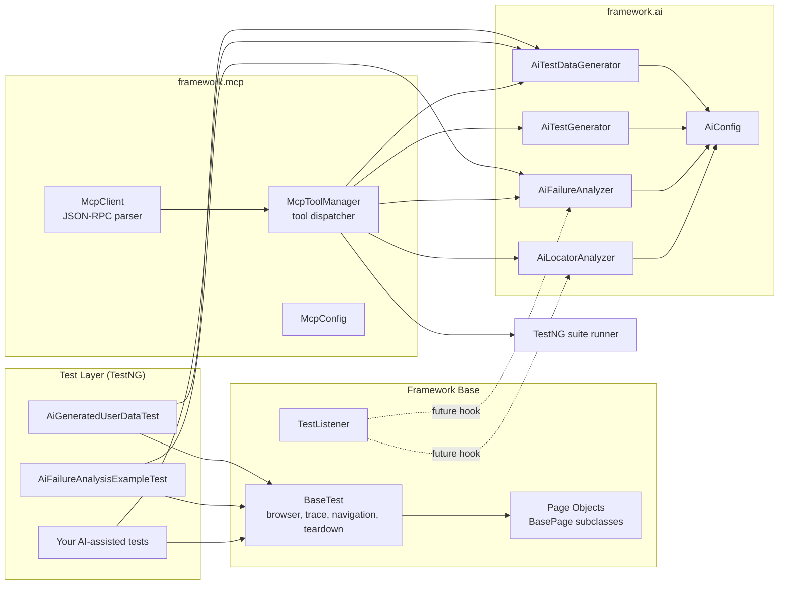

### 2.2 Source file locations

| Area | Class | Path (under `src/main/java/framework/`) |
|---|---|---|
| AI | `AiTestDataGenerator` | `ai/AiTestDataGenerator.java` |
| AI | `AiTestGenerator` | `ai/AiTestGenerator.java` |
| AI | `AiFailureAnalyzer` | `ai/AiFailureAnalyzer.java` |
| AI | `AiLocatorAnalyzer` | `ai/AiLocatorAnalyzer.java` |
| AI | `AiConfig` | `ai/AiConfig.java` |
| MCP | `McpClient` | `mcp/McpClient.java` |
| MCP | `McpToolManager` | `mcp/McpToolManager.java` |
| MCP | `McpConfig` | `mcp/McpConfig.java` |
| Base | `BaseTest` | `base/BaseTest.java` |
| Annotation | `CustomTest` | `annotations/CustomTest.java` |
| Listener | `TestListener` | `listeners/TestListener.java` |

Existing example tests live in `src/test/java/tests/integration/`:
`AiGeneratedUserDataTest`, `AiFailureAnalysisExampleTest`.

---

## 3. AI Layer – What Exists and What It Really Does

### 3.1 Feature matrix

| Feature | Class / method | Output | Reality check |
|---|---|---|---|
| Test data | `AiTestDataGenerator.generateUserDataJson(count)` | JSON array of users | Smart mock / faker. No live LLM call. |
| Test scaffolding | `AiTestGenerator.generateTestSkeleton(requirement)` | JSON: scenarios, page-object skeleton, TestNG skeleton | Template strings. Does **not** write files. |
| Failure analysis | `AiFailureAnalyzer.analyzeFailure(...)` | JSON: category, root cause, fix, locator tip, flaky flag, confidence | Rule-based classification. |
| Locator suggestions | `AiLocatorAnalyzer.analyzeAndSuggestLocators(...)` | Ranked Playwright locator alternatives | Heuristic ranking. |

### 3.2 AI test data generation

Flow used by `AiGeneratedUserDataTest`:

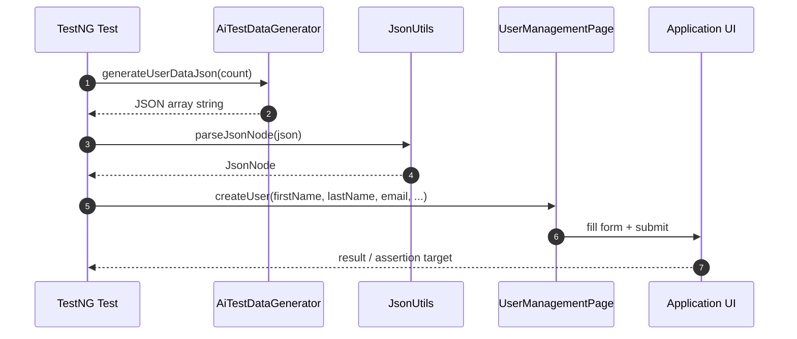

> **Reality check:** with `ai.provider=openai`, the generator only logs that a real LLM call *could* happen here. No API request is implemented.

### 3.3 AI failure analysis

`AiFailureAnalyzer` classifies failures into categories such as:

- `ELEMENT_TIMEOUT`
- `ASSERTION_FAILURE`
- `UNHANDLED_EXCEPTION`

Returned JSON fields: **category · likely root cause · recommended fix · locator recommendation · flaky / not flaky · confidence**.

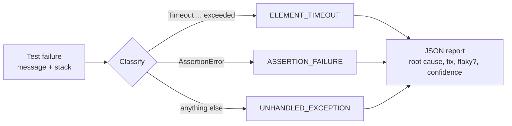

### 3.4 AI locator analysis

`AiLocatorAnalyzer.analyzeAndSuggestLocators(...)` prefers resilient locators in this order:

| Priority | Strategy |
|:---:|---|
| 1 | `getByRole` |
| 2 | `getByLabel` |
| 3 | `getByPlaceholder` |
| 4 | `getByText` |
| 5 | CSS (last resort) |

### 3.5 AI test generation

`AiTestGenerator.generateTestSkeleton("Verify admin can create a user with valid details")` returns JSON with the requirement, scenario ideas, a page-object skeleton, and a TestNG skeleton. You must copy these into real `.java` files yourself.

---

## 4. MCP Layer – Tool Dispatcher

### 4.1 Request flow

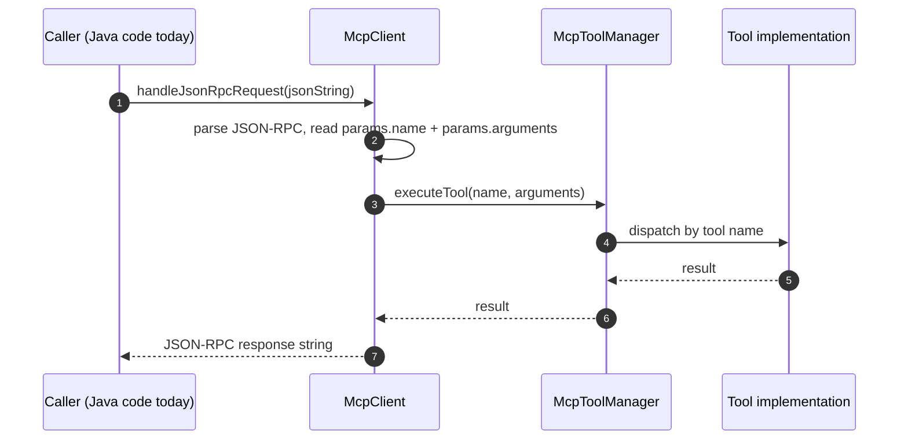

### 4.2 Tool catalogue

| Tool | Purpose | Status |
|---|---|:---:|
| `run_test` | Run a single test class | ⚠️ Placeholder |
| `run_test_suite` | Run a TestNG suite XML | ✅ Works (flat paths only) |
| `get_test_status` | Last-run status | ⚠️ Hardcoded |
| `get_failed_tests` | List failures | ⚠️ Hardcoded |
| `analyze_failure` | Wraps `AiFailureAnalyzer` | ✅ |
| `get_trace` | Playwright trace lookup | ℹ️ Depends on output layout |
| `generate_test_data` | Wraps `AiTestDataGenerator` | ✅ |
| `generate_test_case` | Wraps `AiTestGenerator` | ✅ |
| `find_locator` | Wraps `AiLocatorAnalyzer` | ✅ |
| `validate_api` | API validation | ℹ️ Not verified |
| `execute_database_query` | DB query | ℹ️ Not verified |
| `get_execution_report` | Report lookup | ⚠️ Path lookup needs fixing |

---

## 5. Current Limitations (Read Before You Build)

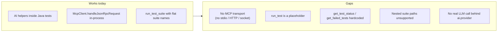

| # | Limitation | Impact | Workaround |
|:-:|---|---|---|
| 1 | **No MCP server transport.** `mcp.serverPort=8080` is configured but nothing listens on it. | External agents (Cursor, Claude, Gemini) cannot connect. | Add a wrapper (§10). |
| 2 | `run_test` only returns *"Triggered test class: …"*. | Single-class runs via MCP do nothing. | Use `mvn -Dtest=...` or `run_test_suite`. |
| 3 | `get_test_status`, `get_failed_tests` are stubbed. | No real run state. | Parse TestNG / Surefire reports yourself. |
| 4 | `run_test_suite` builds `src/test/resources/testng/<suite>.xml`. | Works for `regression`, `parallel`, `api`, `database`; **not** for `icedq/admin/smoke.xml`. | Extend path handling. |
| 5 | `ai.provider=openai` is a log statement only. | Output is not LLM-generated. | Implement provider call (§11, Phase 3). |

---

## 6. Using AI in Tests – Three Patterns

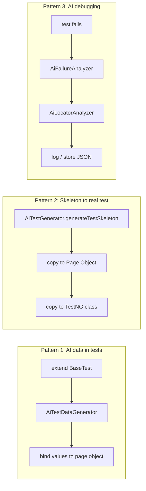

**Pattern 1 – AI-generated data.** Extend `BaseTest` (it provides browser/session setup, tracing, navigation to `baseUrl`, and teardown), use `page()`, create a page object, and fill it with generated values.

**Pattern 2 – Skeleton → real code.** Generate a skeleton, then manually create a page object under `src/main/java/framework/pages/` and a test under `src/test/java/tests/...`, following the `@CustomTest` + `BaseTest` + TestNG conventions.

**Pattern 3 – AI-assisted debugging.** On failure, pass the message to `AiFailureAnalyzer` and broken locator info to `AiLocatorAnalyzer`, then log or store the JSON. `TestListener` is the natural place to automate this later.

### 6.1 End-to-end authoring workflow

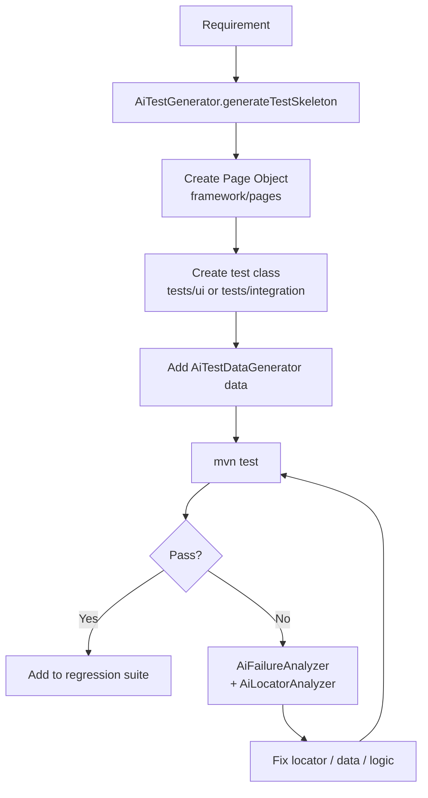

---

## 7. Worked Example – AI-Assisted Registration Test

> These are illustrative classes to add manually. They follow the framework conventions used by `UserCreationTest` and `AiGeneratedUserDataTest`. Adjust locators to your real application.

### 7.1 Page object

`src/main/java/framework/pages/AiGeneratedRegistrationPage.java`

```java
package framework.pages;

import com.microsoft.playwright.Locator;
import com.microsoft.playwright.Page;
import com.microsoft.playwright.options.AriaRole;
import framework.base.BasePage;
import framework.utils.ElementUtils;

public class AiGeneratedRegistrationPage extends BasePage {

    private final Locator firstName;
    private final Locator lastName;
    private final Locator email;
    private final Locator submit;

    public AiGeneratedRegistrationPage(Page page) {
        super(page);
        this.firstName = page.getByLabel("First Name").or(page.locator("#firstName")).first();
        this.lastName  = page.getByLabel("Last Name").or(page.locator("#lastName")).first();
        this.email     = page.getByLabel("Email").or(page.locator("#email")).first();
        this.submit    = page.getByRole(AriaRole.BUTTON,
                new Page.GetByRoleOptions().setName("Register")).first();
    }

    public void register(String f, String l, String e) {
        ElementUtils.fill(firstName, f, "First Name");
        ElementUtils.fill(lastName, l, "Last Name");
        ElementUtils.fill(email, e, "Email");
        ElementUtils.click(submit, "Register Button");
    }
}
```

### 7.2 Test class

`src/test/java/tests/integration/AiGeneratedRegistrationTest.java`

```java
package tests.integration;

import com.fasterxml.jackson.databind.JsonNode;
import framework.ai.AiTestDataGenerator;
import framework.annotations.CustomTest;
import framework.base.BaseTest;
import framework.pages.AiGeneratedRegistrationPage;
import framework.reporting.FrameworkLogger;
import framework.utils.JsonUtils;
import org.testng.Assert;
import org.testng.annotations.Test;

@CustomTest(
    module = "Registration",
    feature = "AI Assisted Registration",
    testType = "INTEGRATION",
    owner = "QA Team"
)
public class AiGeneratedRegistrationTest extends BaseTest {

    @CustomTest(
        testId = "AI_REG_001",
        name = "Register user with AI generated data",
        severity = "CRITICAL",
        priority = "HIGH",
        tags = {"AI", "Registration", "Playwright"}
    )
    @Test(groups = {"ai", "regression"})
    public void testRegisterUserWithAiData() {
        FrameworkLogger.step("Generate 1 AI user");
        String json = AiTestDataGenerator.generateUserDataJson(1);

        JsonNode users = JsonUtils.parseJsonNode(json);
        Assert.assertTrue(users.isArray() && users.size() == 1);

        JsonNode user = users.get(0);

        FrameworkLogger.step("Submit registration form");
        AiGeneratedRegistrationPage registrationPage = new AiGeneratedRegistrationPage(page());
        registrationPage.register(
                user.get("firstName").asText(),
                user.get("lastName").asText(),
                user.get("email").asText()
        );
    }
}
```

> **Stress-test note:** this example has no post-submit assertion – it only proves the form can be filled and submitted. Add a check for a success message or the created record before relying on it as a regression test.

### 7.3 Execution lifecycle

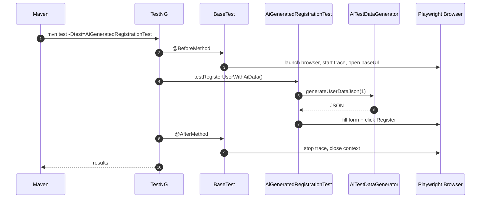

---

## 8. Executing Tests with Maven / TestNG

### 8.1 Command cheat-sheet

```powershell
# A. Single new AI test class
mvn clean test -Dtest=AiGeneratedRegistrationTest

# B. Existing AI examples
mvn clean test -Dtest=AiGeneratedUserDataTest
mvn clean test -Dtest=AiFailureAnalysisExampleTest

# C. Regression suite (includes tests.integration, so AI integration tests run)
mvn clean test -DsuiteXmlFile=src/test/resources/testng/regression.xml

# D. Specific environment / browser / headless
mvn clean test -Denv=qa -Dbrowser=chromium -Dheadless=true -Dtest=AiGeneratedUserDataTest
```

### 8.2 Available suite files

| Suite | Path |
|---|---|
| Regression | `src/test/resources/testng/regression.xml` |
| Parallel | `src/test/resources/testng/parallel.xml` |
| API | `src/test/resources/testng/api.xml` |
| Database | `src/test/resources/testng/database.xml` |
| iceDQ admin smoke (nested) | `src/test/resources/testng/icedq/admin/smoke.xml` |

### 8.3 What `BaseTest` does automatically

1. Initialises the browser session
2. Starts tracing
3. Navigates to the configured `baseUrl`
4. Closes everything after the test

---

## 9. Calling MCP Programmatically

### 9.1 Java invocation

```java
String payload = /* one of the JSON-RPC bodies below */;
String response = McpClient.handleJsonRpcRequest(payload);
System.out.println(response);
```

### 9.2 Example payloads

**Generate test data**

```json
{
  "jsonrpc": "2.0",
  "id": "1",
  "method": "tools/call",
  "params": {
    "name": "generate_test_data",
    "arguments": { "count": "3" }
  }
}
```

**Generate a test skeleton**

```json
{
  "jsonrpc": "2.0",
  "id": "2",
  "method": "tools/call",
  "params": {
    "name": "generate_test_case",
    "arguments": { "requirement": "Verify admin can create user with valid details" }
  }
}
```

**Analyze a failure**

```json
{
  "jsonrpc": "2.0",
  "id": "3",
  "method": "tools/call",
  "params": {
    "name": "analyze_failure",
    "arguments": {
      "testName": "LoginTest",
      "errorMessage": "Timeout 30000ms exceeded while waiting for #login"
    }
  }
}
```

**Run a suite**

```json
{
  "jsonrpc": "2.0",
  "id": "4",
  "method": "tools/call",
  "params": {
    "name": "run_test_suite",
    "arguments": { "suite": "regression" }
  }
}
```

---

## 10. Making MCP a Real External Server (Proposed Wrapper)

To let Cursor, Claude or Gemini call the tools, add a long-running transport process in front of `McpClient`.

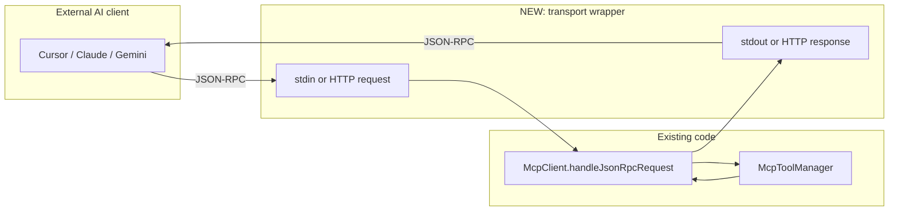

| Option | Best for | Effort |
|---|---|---|
| **stdio wrapper** | Local IDE assistants | Low |
| **HTTP wrapper** | Internal APIs, easy testing | Low |
| **Socket server** | Custom infrastructure | Medium |

### 10.1 Minimal stdio bootstrap (proposed, untested)

> ⚠️ This is a **starting sketch**, not code from your repository. A compliant MCP server must also answer protocol methods such as `initialize` and `tools/list`, which `McpClient` may not handle today. Verify against the MCP specification before pointing a real client at it.

```java
package framework.mcp;

import java.io.BufferedReader;
import java.io.InputStreamReader;

/** Newline-delimited JSON-RPC over stdin/stdout. */
public class McpStdioServer {

    public static void main(String[] args) throws Exception {
        try (BufferedReader in = new BufferedReader(new InputStreamReader(System.in))) {
            String line;
            while ((line = in.readLine()) != null) {
                if (line.isBlank()) continue;
                String response = McpClient.handleJsonRpcRequest(line);
                System.out.println(response);
                System.out.flush();
            }
        }
    }
}
```

### 10.2 Minimal HTTP bootstrap (proposed, untested)

Uses the JDK built-in server and the already-configured `mcp.serverPort`.

```java
package framework.mcp;

import com.sun.net.httpserver.HttpServer;
import java.net.InetSocketAddress;
import java.nio.charset.StandardCharsets;

public class McpHttpServer {

    public static void main(String[] args) throws Exception {
        int port = 8080; // read from mcp.serverPort in real code
        HttpServer server = HttpServer.create(new InetSocketAddress("127.0.0.1", port), 0);

        server.createContext("/mcp", exchange -> {
            if (!"POST".equals(exchange.getRequestMethod())) {
                exchange.sendResponseHeaders(405, -1);
                return;
            }
            String body = new String(exchange.getRequestBody().readAllBytes(), StandardCharsets.UTF_8);
            byte[] out = McpClient.handleJsonRpcRequest(body).getBytes(StandardCharsets.UTF_8);
            exchange.getResponseHeaders().add("Content-Type", "application/json");
            exchange.sendResponseHeaders(200, out.length);
            exchange.getResponseBody().write(out);
            exchange.close();
        });

        server.start();
        System.out.println("MCP HTTP server listening on http://127.0.0.1:" + port + "/mcp");
    }
}
```

Binding to `127.0.0.1` is deliberate: `run_test_suite` and `execute_database_query` are powerful, and exposing them on a network interface without authentication would be a security risk.

Quick check once running:

```powershell
curl -X POST http://127.0.0.1:8080/mcp -H "Content-Type: application/json" `
  -d '{"jsonrpc":"2.0","id":"1","method":"tools/call","params":{"name":"generate_test_data","arguments":{"count":"2"}}}'
```

---

## 11. Roadmap

```mermaid
gantt
    title Recommended phases (relative effort, not dates)
    dateFormat  X
    axisFormat  %s
    section Phase 1 - Use what works
    Mock AI helpers in tests       :done, p1a, 0, 2
    Diagnostics with analyzers     :done, p1b, 0, 2
    section Phase 2 - Make MCP actionable
    Real run_test execution        :p2a, 2, 4
    Real status + failed tests     :p2b, 2, 5
    Nested suite paths             :p2c, 3, 4
    Transport wrapper              :p2d, 4, 6
    section Phase 3 - Real LLM
    Provider call in AiConfig users :p3a, 6, 9
    Generated tests written to files:p3b, 8, 10
```

| Phase | Goal | Key work |
|:-:|---|---|
| **1** | Use what already works | Keep `ai.provider=mock`; scaffold with `AiTestGenerator`; use `AiTestDataGenerator` for runtime data; diagnose with the analyzers; run via Maven/TestNG. |
| **2** | Make MCP useful to agents | Make `run_test` really execute; return real status and failures; support nested suite paths like `icedq/admin/smoke`; fix report lookup; add transport wrapper. |
| **3** | Make AI truly LLM-backed | Implement the provider call in `AiTestDataGenerator`, `AiTestGenerator`, optionally `AiFailureAnalyzer`, using `ai.provider`, `ai.model`, `ai.apiKey` from `AiConfig`. Keep API keys out of source control. |

---

## 12. Quick Reference

### Decision guide

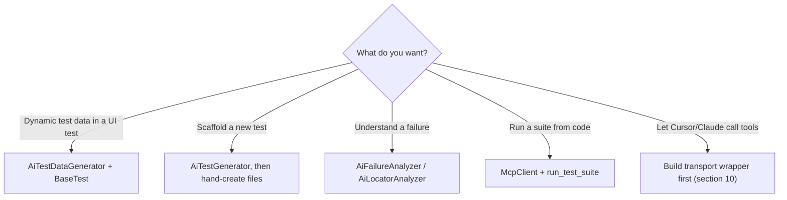

### Shortest path commands

```powershell
mvn clean test -Dtest=AiGeneratedUserDataTest
mvn clean test -Dtest=AiFailureAnalysisExampleTest
mvn clean test -DsuiteXmlFile=src/test/resources/testng/regression.xml
```

### Glossary

| Term | Meaning |
|---|---|
| **MCP** | Model Context Protocol – a JSON-RPC based protocol for exposing tools to AI clients. |
| **JSON-RPC** | Request/response format used by `McpClient` (`jsonrpc`, `id`, `method`, `params`). |
| **TestNG** | Test runner used with Maven Surefire. |
| **Page Object** | Class that wraps a page's locators and actions (`BasePage` subclasses). |
| **Transport** | The channel (stdio / HTTP / socket) that carries JSON-RPC to the server. |

---

*Source: analysis of the `playwright-mcp-automation` project. Sections 7 and 10 contain illustrative / proposed code that is not part of the repository and has not been compiled or run.*
