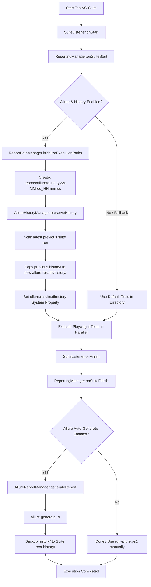
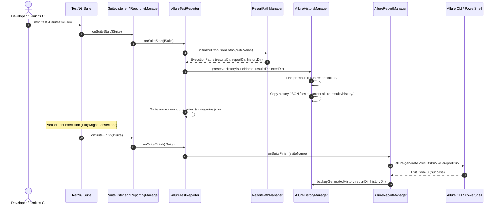

# Advanced Allure Report & History Management Guide

This document details the architecture, design patterns, lifecycle flow, configuration, and execution methods for **Advanced Allure History and Report Management** in the Playwright + Java + TestNG automation framework.

---

## 1. Overview & Architecture

The Allure History Management subsystem provides isolated, timestamped test runs while maintaining historical execution trends (pass/fail trends, retry history, duration metrics, and defect categories) across test suites.

### Core Design Principles:
- **Zero-Breaking Invariance**: Runs in parallel with existing reporting engines (ExtentReports, ChainTest, ELK Stack, Database).
- **Suite-Level Run Isolation**: Generates a dedicated folder for each execution named `<SuiteName>_<yyyy-MM-dd_HH-mm-ss>`.
- **Automatic History Trend Stitching**: Before test execution / report generation, history artifacts (`history.json`, `history-trend.json`, `duration-trend.json`, `retry-trend.json`, `categories-trend.json`) are retrieved from the previous suite run and injected into the current `allure-results/history/`.
- **Automated CLI Invocation**: Integrates process automation for `allure generate <results> -o <report>` and provides a standalone, feature-rich PowerShell utility (`run-allure.ps1`).

---

## 2. Directory Layout

```
reports/
└── allure/
    ├── UserSuite_2026-10-07_11-45-20/
    │   ├── allure-results/
    │   │   ├── history/                   <-- Staged from previous run
    │   │   │   ├── history.json
    │   │   │   ├── history-trend.json
    │   │   │   ├── duration-trend.json
    │   │   │   ├── retry-trend.json
    │   │   │   └── categories-trend.json
    │   │   ├── environment.properties
    │   │   ├── categories.json
    │   │   ├── executor.json
    │   │   └── *-result.json
    │   ├── allure-report/                 <-- Generated interactive HTML report
    │   │   ├── index.html
    │   │   ├── history/
    │   │   ├── data/
    │   │   └── widgets/
    │   └── history/                       <-- Backup archive
    │
    └── AdminSuite_2026-10-07_14-10-05/
        ├── allure-results/
        │   └── history/
        ├── allure-report/
        └── history/
```

---

## 3. Workflow Diagrams

### 3.1. Execution Flow



### 3.2. Sequence Diagram



---

## 4. Java Utility Classes

| Class | Package | Responsibility |
|---|---|---|
| `ReportPathManager` | `framework.reporting.allure` | Resolves timestamped execution directory paths, provides active paths, and locates past suite runs. |
| `AllureHistoryManager` | `framework.reporting.allure` | Manages file copying between past reports and active result folders to preserve history trends. |
| `AllureReportManager` | `framework.reporting.allure` | Invokes the Allure CLI process cross-platform (`cmd.exe /c allure` on Windows, `allure` on POSIX) and handles suite lifecycle hooks. |
| `AllureTestReporter` | `framework.reporting.reporters` | Implements `TestReporter`, attaching environment, categories, execution parameters, steps, and failure artifacts. |
| `ReportingConfig` | `framework.config` | Exposes configuration flags and fallback defaults. |

---

## 5. Configuration Reference

In `src/test/resources/config/config.properties`:

```properties
# =============================================================================
# ALLURE REPORT & HISTORY MANAGEMENT
# =============================================================================
# Enable / disable Allure reporting integration
allure.enabled=true

# Enable / disable automatic history preservation across suite executions
allure.history.enabled=true

# Base folder where all timestamped execution folders are stored
allure.base.path=reports/allure

# Automatically generate HTML report at the end of the TestNG suite execution
allure.auto.generate=true
```

---

## 6. PowerShell Script Reference (`run-allure.ps1`)

The script `run-allure.ps1` in the project root provides complete CLI and interactive report management.

### Parameters:
- `-SuiteName` *(string, optional)*: Filter for a specific suite (e.g. `-SuiteName "UserSuite"`). If omitted, finds the latest execution across all suites.
- `-ExecutionDir` *(string, optional)*: Explicit path to an execution folder.
- `-Action` *(ValidateSet: `GenerateAndOpen`, `GenerateOnly`, `OpenOnly`, `Serve`)*:
  - `GenerateAndOpen` *(Default)*: Preserves history, runs `allure generate --clean`, and opens the report in browser.
  - `GenerateOnly`: Preserves history and generates HTML report without starting a browser.
  - `OpenOnly`: Opens the existing report on the specified port.
  - `Serve`: Runs `allure serve` on the results folder.
- `-Port` *(int, default: 8088)*: Port number for the Allure HTTP server.

### Usage Examples:

```powershell
# 1. Generate & open latest report across all suites
.\run-allure.ps1

# 2. Generate & open report for a specific suite
.\run-allure.ps1 -SuiteName "UserSuite"

# 3. Headless generation (ideal for CI/CD or background tasks)
.\run-allure.ps1 -Action "GenerateOnly"

# 4. Open existing report on port 9090
.\run-allure.ps1 -Action "OpenOnly" -Port 9090

# 5. Direct Allure serve
.\run-allure.ps1 -Action "Serve"
```

---

## 7. CI/CD & Jenkins Integration

### 7.1. Pipeline Script (`Jenkinsfile`)

```groovy
pipeline {
    agent any
    
    stages {
        stage('Execute Tests') {
            steps {
                bat 'mvn clean test -DsuiteXmlFile=src/test/resources/testng/icedq/regression.xml'
            }
        }
        
        stage('Generate Allure Report') {
            steps {
                powershell '''
                    .\\run-allure.ps1 -Action "GenerateOnly"
                '''
            }
        }
    }
    
    post {
        always {
            allure([
                includeProperties: true,
                jdk: '',
                properties: [],
                reportBuildPolicy: 'ALWAYS',
                results: [[path: 'reports/allure/*/allure-results']]
            ])
        }
    }
}
```

---

## 8. Rollback & Troubleshooting

### Rollback Strategy
If you ever want to bypass dynamic suite directory generation:
1. In `config.properties`, set:
   ```properties
   allure.history.enabled=false
   allure.auto.generate=false
   ```
2. Or pass JVM system arguments during maven test:
   ```bash
   mvn test -Dallure.history.enabled=false -Dallure.results.directory=reports/allure-results
   ```

### Troubleshooting
- **Allure command not found**: Ensure Allure CLI is installed and in PATH (`scoop install allure` or `choco install allure-commandline -y`).
- **History not appearing on first run**: The first run establishes the baseline. Trend graphs will populate from the 2nd execution onwards.
- **Port already in use**: Use `-Port <new-port>` (e.g. `.\run-allure.ps1 -Port 8099`).
